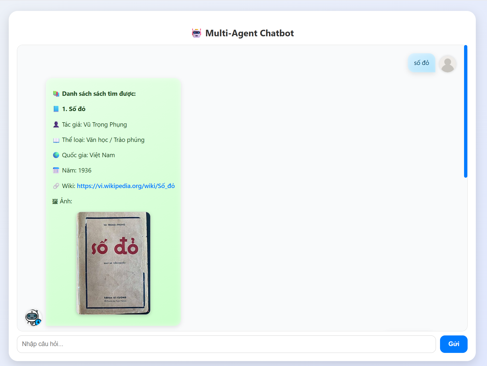
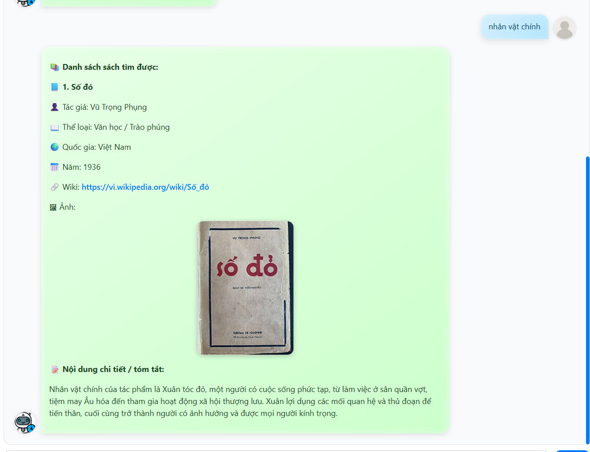

có thể xem trực tiếp thao tác  cài đặt bằng file demo.pptx


# 📚 HỆ THỐNG AGENT SÁCH

Tài liệu này hướng dẫn **cách vận hành** và **kiến trúc hệ thống Agent Sách**, được biên soạn theo chuẩn `README.md`, dễ dàng import và trình bày lại bằng **Canva Markdown**.

### 🖼 Giao diện demo

**Tìm sách theo tên** — hệ thống trả về thông tin chi tiết và ảnh bìa:



**Hỏi nội dung sách** — hệ thống truy xuất nội dung (RAG) và tóm tắt câu trả lời:



---

## 🚀 HƯỚNG DẪN VẬN HÀNH HỆ THỐNG

Hệ thống hỗ trợ **2 cách chạy**: **Docker (khuyên dùng)** và **chạy thủ công**.

---

## 🛠 Cách 1: Chạy bằng Docker (Khuyên dùng – Tự động 100%)

Cách này **tự động**:
- Cài đặt PostgreSQL
- Cài extension `pgvector`
- Thiết lập môi trường Python

### 🔧 Chuẩn bị

1. Đảm bảo đã cài:
   - Docker
   - Docker Compose

2. Thiết lập API key của OpenAI trong môi trường:

```powershell
$env:OPENAI_API_KEY = "your-api-key"
```

> 🔑 Tạo API key tại [OpenAI Platform](https://platform.openai.com/api-keys). Khi dùng Docker Compose, truyền biến `OPENAI_API_KEY` từ môi trường máy chủ. Có thể chọn mô hình trả lời bằng `OPENAI_MODEL` (mặc định `gpt-4.1-mini`).

> Embedding cũ từ Gemini không tương thích với OpenAI. Bảng vector hiện dùng mảng số PostgreSQL, không yêu cầu extension `pgvector`.

---

### ▶️ Chạy hệ thống

Mở Terminal/CMD tại thư mục dự án và chạy:

```bash
docker-compose up --build
```

---

### ✅ Kiểm tra


- Nếu log hiển thị:

```
Kết nối Database thành công
```

➡️ Hệ thống đã sẵn sàng.

---

## 🛠 Chạy trực tiếp trên Windows

Áp dụng khi bạn **không sử dụng Docker**.

---

### Bước 1: Cài đặt thư viện Python

```powershell
python -m venv .venv
.\.venv\Scripts\python.exe -m pip install -r requirements.txt
```

---

### Bước 2: Thiết lập Database

Đặt thông tin kết nối và API key trong file `.env` (không commit file này):

```text
DB_HOST=localhost
DB_PORT=5432
DB_NAME=booksdb
DB_USER=postgres
DB_PASS=mật-khẩu-postgres-của-bạn
OPENAI_API_KEY=khóa-openai-của-bạn
```

Để nhập 100 dòng metadata từ CSV vào PostgreSQL cục bộ, chạy:

```powershell
.\.venv\Scripts\python.exe import_csv.py
```

Script cập nhật theo cột `id` của CSV nên có thể chạy lại mà không tạo bản ghi trùng. Bảng `books_metadata` không cần OpenAI API key.

1. Cài **PostgreSQL** và kiểm tra dịch vụ đang chạy trên cổng 5432
2. Tạo database:

```sql
CREATE DATABASE booksdb;
```

3. Tạo vector từ các trang Wikipedia trong CSV:

```powershell
.\.venv\Scripts\python.exe vectordb.py
```

Script lưu embedding 1024 chiều dưới dạng `DOUBLE PRECISION[]` trong bảng `books_vector`, có thể chạy lại để tiếp tục các sách chưa được lập chỉ mục. Tìm kiếm dùng cosine similarity trên các vector của sách được hỏi. Có thể chạy `app.py` trước bước này; Agent 5 sẽ tự lập chỉ mục sách khi được hỏi về nội dung.

---

## 🚀 QUY TRÌNH KHỞI ĐỘNG ỨNG DỤNG

> Áp dụng sau khi PostgreSQL cục bộ và bảng `books_metadata` đã sẵn sàng. Bảng `books_vector` được tạo tự động khi lập chỉ mục.

### Tùy chọn: chạy API quản lý vector

```powershell
.\.venv\Scripts\python.exe -m infrastructure.tool4
```

### Chạy ứng dụng chính (Flask API & Smart Agent)

Ứng dụng đọc danh sách sách trực tiếp từ PostgreSQL; không cần chạy API quản lý vector ở cổng 5000.

```powershell
.\.venv\Scripts\python.exe app.py
```

---

## 📦 DANH SÁCH THƯ VIỆN (`requirements.txt`)

```txt
flask
flasgger
psycopg2-binary
openai
langgraph
requests
beautifulsoup4
numpy
regex
seaborn
matplotlib
```

---

## ⚠️ LƯU Ý QUAN TRỌNG

- 🔁 **Thứ tự**: Database phải chạy trước `app.py`
- 🌐 **Host DB**:
  - Docker: `host = db`
  - Chạy thủ công: đổi thành `host = localhost`
- 🔑 **OpenAI API**:
  - Lỗi `429` → kiểm tra quota API

---

# 🏗 TÀI LIỆU KIẾN TRÚC HỆ THỐNG AGENT

Hệ thống được thiết kế theo **Layered Architecture (4 tầng)**, đảm bảo **tách biệt trách nhiệm** và **dễ mở rộng**.

---


## 1️⃣ Controller Layer (Giao diện & Entry Point)

**File đại diện:** `app.py`

### Vai trò
- Điểm vào duy nhất của hệ thống
- Kết nối User ↔ AI

### Chức năng
- Định nghĩa RESTful API
- Nhận câu hỏi từ người dùng
- Gửi yêu cầu xuống Flow
- Trả kết quả JSON
- Quản lý Swagger UI

---

## 2️⃣ Flow Layer (Điều phối & Quy trình)

**Thư mục:** `flow/`

### Vai trò
- Điều phối toàn bộ Agent
- Chứa **Agent 1 – Trưởng nhóm**

### Chức năng
- Planning: Phân tích yêu cầu
- Orchestration: Điều phối Agent 4 / 5
- Dùng OpenAI phân loại ngữ nghĩa câu hỏi và giữ tên sách đang xem cho câu hỏi tiếp nối
- Điều phối từng lượt bằng `LangGraph`; giao diện gửi kèm tên sách của lượt trước

---

## 3️⃣ Logic Layer (Nghiệp vụ AI)

**Thư mục:** `logic/`

**Ví dụ:** `agent4.py`, `agent5.py`

### Vai trò
- Hiện thực tư duy riêng cho từng Agent

### Chức năng
- Xây dựng prompt cho từng Agent
- Xử lý dữ liệu nghiệp vụ
- Chuẩn hóa đầu ra trước khi trả về Flow

---

## 4️⃣ Infrastructure Layer (Hạ tầng kỹ thuật)

**Thư mục:** `infrastructure/`

**Ví dụ:** `model.py`, `tool4.py`, `database.py`

### Vai trò
- Tầng thấp nhất – làm việc với tài nguyên thô

### Chức năng
- Cấu hình OpenAI Model & Embedding
- Prompt Templates
- Kết nối PostgreSQL và lưu embedding dạng mảng số
- Vector Search
- Web Scraping (Wikipedia)

---

## 🔄 TÓM TẮT LUỒNG DỮ LIỆU (DATA FLOW)

```text
User
 ↓
Controller (app.py)
 ↓
Flow (Agent 1)
 ↓
Logic (Agent 4 / 5)
 ↓
Infrastructure (DB / Model)
 ↑
Logic
 ↑
Flow
 ↑
Controller
 ↑
User
```

---

## 🎯 KẾT LUẬN – DEPENDENCY RULE

### 🔒 Nguyên tắc cốt lõi
> **Dependency chỉ được phép hướng vào lõi (Infrastructure)**

---

### 1️⃣ Ràng buộc phụ thuộc

- Controller → Flow
- Flow → Logic
- Logic → Infrastructure

⛔ Không được import ngược chiều

---

### 2️⃣ Tính độc lập của lõi (Core)

- Infrastructure **không biết ai gọi nó**
- Chỉ làm đúng nhiệm vụ:
  - Kết nối DB
  - Tạo Embedding
  - Vector Search

➡️ Thay đổi UI hoặc Framework **không ảnh hưởng lõi**

---

### 3️⃣ Data Flow vs Dependency

- Data Flow: 2 chiều
- Dependency: 1 chiều (ngoài → trong)

```text
Infrastructure ❌ không bao giờ import Controller
```

---

## ✅ VÌ SAO KIẾN TRÚC NÀY ĐƯỢC COI LÀ \"CHUẨN\"?

Kiến trúc Layered Architecture được áp dụng trong hệ thống Agent Sách không chỉ mang tính hình thức, mà đáp ứng trực tiếp các **tiêu chí kỹ thuật cốt lõi** trong phát triển phần mềm hiện đại.

---

### 🔹 1️⃣ Tính độc lập (Independence)

Mỗi tầng trong hệ thống được **tách biệt rõ ràng về trách nhiệm**.

- Khi muốn **đổi Database**:
  - Ví dụ: PostgreSQL ➜ MongoDB
  - 👉 Chỉ cần chỉnh sửa ở **Infrastructure Layer** (`database.py`, `tool*.py`)
  - ❌ Không ảnh hưởng Flow, Logic hay Controller

➡️ Điều này giúp hệ thống **không bị khóa cứng (vendor lock-in)** vào một công nghệ cụ thể.

---

### 🔹 2️⃣ Dễ kiểm thử (Testability)

Do các tầng không phụ thuộc ngược chiều:

- Có thể **test độc lập từng Agent**
- Ví dụ:
  - Kiểm thử Logic của **Agent 4**
  - Không cần:
    - Chạy Flask server
    - Kết nối Database thật

➡️ Phù hợp với:
- Unit Test
- Mock Tool / Mock Database
- Phát triển theo hướng TDD

---

### 🔹 3️⃣ Dễ mở rộng (Extensibility)

Khi hệ thống cần mở rộng nghiệp vụ:

- Ví dụ: Thêm **Agent 6 – So sánh sách**

Quy trình thực hiện:
1. Thêm file mới vào `logic/agent6.py`
2. Định nghĩa năng lực Agent 6
3. Cập nhật Flow để Agent 1 biết khi nào gọi Agent 6

🚫 Không cần sửa:
- Database
- Controller
- Các Agent cũ

➡️ Giảm rủi ro **regression bug**, hệ thống phát triển tuyến tính và an toàn.

---

### 🔹 4️⃣ Phù hợp chuẩn Clean Architecture

Kiến trúc tuân thủ các nguyên lý:

- Separation of Concerns
- Dependency Inversion
- Stable Core

➡️ Đây là lý do kiến trúc này thường được sử dụng trong:
- Hệ thống AI Agent
- Backend lớn
- Microservice / Modular Monolith

---

📌 **Tài liệu này phù hợp để:**
- Import vào **Canva Markdown**
- Làm tài liệu báo cáo đồ án
- Thuyết trình kiến trúc hệ thống
- Onboard thành viên mới
- Thực hành Clean Architecture chuẩn

---

✅ **END OF README****

